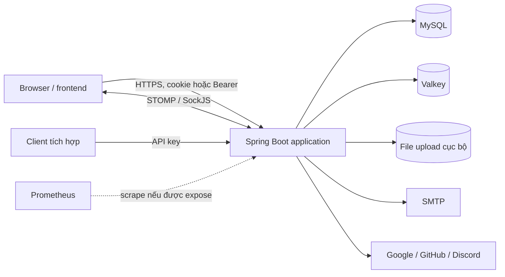

# Tài liệu kỹ thuật và kiến trúc hệ thống

Tài liệu này mô tả **mã nguồn và cấu hình hiện tại trong workspace**, không khẳng định cấu hình đang chạy trên production. Các liên kết API chi tiết ở cuối tài liệu có thể chứa thông tin cũ; khi khác nhau, kiểm tra controller và `SecurityConfig`.

## 1. Tổng quan

Blog Platform là một ứng dụng backend Spring Boot dạng **modular monolith**: các domain nằm trong cùng một process, cùng triển khai và dùng chung database. Hệ thống cung cấp quản lý bài viết, series, bình luận, hồ sơ, thông báo, newsletter và API tích hợp.



Sơ đồ thể hiện các thành phần và kết nối trong source/config, không khẳng định các dịch vụ bên ngoài đã được cấu hình hoặc kiểm thử trong runtime thực tế.

## 2. Công nghệ và cấu trúc

| Thành phần | Hiện trạng |
|---|---|
| Runtime và build | Java 25, Gradle Wrapper 9.2.0, Spring Boot `4.1.2` |
| Web và bảo mật | Spring MVC, Spring Security, JWT, OAuth2 client, CSRF |
| Persistence | Spring Data JPA/Hibernate, MySQL, các SQL migration trong `src/main/resources/db/migration` |
| Cache/queue | `ConcurrentMapCacheManager` trong từng process; Valkey qua Glide cho view buffer, rate limit, khóa và email stream |
| Realtime | WebSocket STOMP, SockJS, simple broker trong process |
| Khác | SMTP, Spring scheduling, Prometheus registry, OpenAPI, Apache POI/iText |

Cấu trúc chính dưới `src/main/java/com/Nguyen/blogplatform`:

- `domain/<domain>/api`: controller HTTP; `application`: nghiệp vụ; `domain/model`: entity; `infrastructure/repository`: truy xuất dữ liệu; `dto`: dữ liệu API.
- `infrastructure`: security, storage, cấu hình và seed.
- `shared`: mapper, exception, validation và tiện ích dùng chung.
- `src/main/resources`: profile cấu hình, migration, template email và logging.

Các domain gồm `auth`, `user`, `post`, `series`, `comment`, `report`, `admin`, `search`, `notification`, `newsletter`, `media`, `analytics`, `apikey`, `operations` và `shared`. Cách chia này giúp tổ chức mã; không phải ranh giới mạng hay quyền truy cập riêng.

## 3. Dữ liệu và nghiệp vụ

- **User và role:** user có thể có nhiều role; kiểm tra quyền dùng Spring Security và một số kiểm tra ownership ở service/controller. Role cũ không có tiền tố được chuẩn hóa thành `ROLE_*` khi tạo principal.
- **Post:** tác giả quản lý bài, trạng thái, tag và category. Post có like, rating, comment và bookmark. Nội dung public được lọc theo trạng thái và thời điểm xuất bản ở những luồng có áp dụng kiểm tra đó.
- **Series:** nhóm và sắp xếp bài; các thao tác ghi dùng user hiện tại và kiểm tra trong service.
- **Comment:** comment có parent, depth, reply count; danh sách replies được lấy theo từng tầng với SQL giới hạn theo parent. Các sửa đổi làm mất hiệu lực cache comment/reply.
- **Report/admin:** user tạo báo cáo; API admin xử lý moderation, tài khoản và analytics.
- **Profile:** public theo slug; hồ sơ chi tiết hiện tại theo principal; admin có route riêng xem chi tiết theo user ID.
- **Media/newsletter:** quản lý upload và nội dung media; newsletter có campaign, subscription và các tác vụ định kỳ.

## 4. Xác thực và phân quyền

`SecurityConfig` áp dụng các matcher theo thứ tự và có `anyRequest().authenticated()` ở cuối. Kiểm tra chính xác route và method tại source khi thay đổi API.

### Browser: JWT trong cookie

1. Gọi `GET /api/v1/auth/csrf` với `credentials: include`. Response chứa `headerName` và `token`; giữ session cookie.
2. Gửi `POST /api/v1/auth/login` hoặc `/register` cùng CSRF header và credentials. Backend đặt access token và refresh token trong cookie `HttpOnly`.
3. Request tiếp theo gửi cookie tự động. Với method thay đổi dữ liệu, gửi CSRF header. Gọi `/api/v1/auth/me` để lấy principal.
4. Khi access token hết hạn, `POST /api/v1/auth/refresh-token` với cookie và CSRF token để cấp access token và xoay refresh token. Frontend cần điều phối các request refresh đồng thời.
5. `POST /api/v1/auth/logout` yêu cầu đăng nhập và CSRF; backend cố thu hồi token và xóa cookie.

Local: access token `180000 ms` = 3 phút, refresh token `604800000 ms` = 7 ngày. Production lấy thời hạn từ `JWT_EXPIRATION` và `REFRESH_TOKEN_EXPIRATION` tính bằng **milliseconds**; giá trị runtime chưa được xác minh. JWT và cookie access có cùng thời hạn cấu hình. Cookie auth đặt `SameSite=Lax`; production đặt `Secure=true`. Với frontend/backend khác site cần thiết kế cookie, session, CORS và CSRF phù hợp thay vì giả định cấu hình này hoạt động.

CSRF matcher hiện yêu cầu token đối với method không an toàn khi request có cookie, hoặc khi request không có Bearer/API key. Request không có cookie và có header Bearer hoặc cặp header API key được miễn CSRF; xác thực và phân quyền vẫn xử lý ở filter/controller. Endpoint `/api/v1/auth/csrf` dùng session, nên tính sẵn sàng của session và hành vi qua load balancer cần được xác minh khi chạy nhiều instance.

### Bearer, OAuth và API key

- `AuthTokenFilter` nhận JWT từ cookie trước, sau đó thử `Authorization: Bearer`. Token được kiểm tra chữ ký, expiry, blacklist và trạng thái user.
- OAuth2 redirect dùng session cho authorization request; callback đặt cookie rồi redirect tới `${FRONTEND_URL}/oauth2/redirect`, không đưa JWT vào URL. Các API OAuth token riêng cũng có trong `OAuthController`.
- API key có secret được hash; filter chỉ xử lý đường dẫn `/api/v1/external/**`. API key và secret gửi qua `X-API-KEY` / `X-API-SECRET`. Route external hiện yêu cầu authentication, do đó cũng có thể nhận JWT; không nên mô tả đây là chính sách chỉ chấp nhận API key.
- CORS cho phép origin trong `frontend-url`, credentials và các method được liệt kê trong `SecurityConfig`.

**Contract profile:** `GET /api/v1/users/profile/{slug}` public; `GET /api/v1/profile` cho user hiện tại; `GET /api/v1/admin/users/{userId}/profile` cho admin. Các route profile theo username/ID cũ đã được gỡ; client phải chuyển route trước khi rollout.

Chi tiết tích hợp: [AUTHENTICATION.md](AUTHENTICATION.md), [OAUTH.md](OAUTH.md), [PROFILE_CUSTOMIZATION_API.md](PROFILE_CUSTOMIZATION_API.md), [API_KEY_AND_EXTERNAL_INTEGRATION.md](API_KEY_AND_EXTERNAL_INTEGRATION.md).

## 5. Một số luồng xử lý

### Bài viết, bookmark và thống kê

Controller nhận request, service kiểm tra nghiệp vụ và repository truy xuất MySQL. Post list và saved posts có các truy vấn batch để lấy thống kê và quan hệ sau khi lấy trang. Bookmark list vẫn có endpoint không phân trang; cần cân nhắc kích thước dữ liệu khi sử dụng. Thống kê user dùng các query aggregate theo tác giả; thống kê đọc theo tháng/năm hiện cộng view dựa trên **ngày tạo bài**, không phải chuỗi sự kiện view theo ngày.

### View count

`ViewCountService` dùng Valkey key theo entity và IP để khử trùng 24 giờ; buffer được đồng bộ định kỳ 10 phút. Lua script tạo batch pending; database ghi batch ID vào `view_sync_batch` và cập nhật counter trong transaction; sau đó ACK batch ở Valkey. Thiết kế nhằm hỗ trợ retry và tránh ghi trùng, nhưng chưa được kiểm thử đầy đủ với lỗi giữa MySQL/Valkey, restart hoặc nhiều instance. SQL `INSERT IGNORE` và migration hiện hướng tới MySQL. Cần có bảng từ `V5__view_sync_batches.sql` trước khi bật luồng này.

### Notification và email

Sau commit tạo comment, dispatcher gửi notification bất đồng bộ qua bean riêng. Email service ghi sự kiện vào Valkey Stream; consumer poll mỗi 5 giây và ACK sau khi gửi. Lỗi để message ở pending entries; code đang đọc message mới bằng `XREADGROUP ... >`, chưa thấy cơ chế claim/retry pending hoàn chỉnh. Không coi đây là bảo đảm gửi email thành công hoặc bảo đảm exactly-once.

### Scheduled tasks

Các job gồm xuất bản bài hẹn giờ, đồng bộ view, dọn token và newsletter. Job publish dùng khóa Valkey; các job khác cần được đánh giá riêng khi chạy nhiều instance. Giờ cron phụ thuộc timezone của runtime nếu không cấu hình rõ.

## 6. Triển khai và cấu hình

`Dockerfile` build JAR và chạy bằng user không phải root; upload được ghi dưới `/app/uploads`. `docker-compose.yml` khai báo MySQL 8.4, Valkey 8, app, Prometheus và Grafana; không khai báo Kafka hay SMTP. Kafka dependency trong Gradle không chứng minh rằng hệ thống đang sử dụng Kafka cho notification.

Các cấu hình cần đối chiếu với môi trường đích: `SPRING_PROFILES_ACTIVE`, `DB_URL`, `DB_USERNAME`, `DB_PASSWORD`, `REDIS_HOST`, `REDIS_PORT`, `REDIS_PASSWORD`, `JWT_SECRET`, `JWT_EXPIRATION`, `REFRESH_TOKEN_EXPIRATION`, `BASE_URL`, `FRONTEND_URL`, mail, OAuth và Telegram. Không đưa giá trị bí mật vào tài liệu hay commit. Với Compose, DB/Valkey URL phải phù hợp mạng container.

**Các điểm cần giải quyết trước rollout:**

1. `application-prod.yml` đặt `ddl-auto: validate`, nhưng Compose đặt `SPRING_JPA_HIBERNATE_DDL_AUTO: update`, có ưu tiên cao hơn và thay đổi hành vi thực tế. Xác nhận/cập nhật cấu hình triển khai trước khi chạy.
2. Có SQL migration trong `db/migration` và dependency `flyway-mysql`; chưa xác nhận cơ chế Flyway tự chạy trong runtime hiện tại. Kiểm tra migration history, schema và áp dụng V5 theo quy trình môi trường trước khi dùng view sync. Không mặc định chạy migration trên database đang có dữ liệu.
3. `ValkeyConfig` hiện cấu hình host/port cho Glide nhưng không thấy truyền password. Cấu hình `REDIS_PASSWORD` trong YAML không chứng minh Glide đăng nhập được Valkey có mật khẩu.
4. Upload nằm trên filesystem container; Compose chưa cấu hình volume cố định cho app. Xác nhận cơ chế lưu bền, backup và chia sẻ file giữa instance.
5. Chỉ `health,info` được expose theo `application.yml`; endpoint `/actuator/**` không mặc nhiên public, ngoại trừ health trong security config. Prometheus cần cấu hình expose và bảo vệ riêng trước khi scrape.
6. Cache Spring và simple WebSocket broker là **in-memory theo instance**; không giả định cache invalidation hoặc broadcast đồng bộ giữa nhiều instance. Session cho OAuth/CSRF cũng cần chiến lược phù hợp khi scale.
7. Kiểm tra frontend origin, cookie, proxy HTTPS/forwarded headers, OAuth callback, SMTP và WebSocket trên domain đích. Trạng thái các tích hợp này chưa được xác nhận ở production.

## 7. Build, kiểm thử và vận hành

```bash
./gradlew test
./gradlew bootJar
```

Test hiện có unit test và `@SpringBootTest`; cấu hình mặc định kích hoạt `local`, trỏ tới MySQL local và `ddl-auto: update`. **Không chạy test tùy tiện với datasource chứa dữ liệu quan trọng.** Nên cung cấp database test tách biệt và xác nhận cấu hình được resolve trước khi chạy. Việc test pass không xác nhận Docker image, OAuth provider, trình duyệt, gửi email hay triển khai thực tế.

Quan sát tối thiểu: kiểm tra health, log ứng dụng, kết nối MySQL/Valkey, backlog view pending và Valkey Stream, tiến trình scheduled job và lỗi gửi mail. `GET /actuator/health` được permit; các endpoint khác tùy exposure/security. Không ghi JWT, cookie hay secret vào log.

## 8. Giới hạn và việc còn lại

- Cần kiểm thử tích hợp riêng cho transaction/retry view sync, đặc biệt lỗi giữa commit database và ACK Valkey; cần chiến lược bảo trì bảng batch marker theo yêu cầu vận hành.
- Cần database test riêng, test số query với dữ liệu đủ lớn và kiểm chứng frontend cookie/CSRF/OAuth end-to-end.
- Xem lại chính sách CSRF, logout/thu hồi token, phân quyền toàn bộ API và WebSocket trước khi công khai; test hiện có không chứng minh mọi route an toàn.
- Các cấu hình mẫu, tài liệu API cũ và README có thể khác code; kiểm tra source hoặc OpenAPI runtime. README cũ có các mô tả như stateless/scaling không phản ánh đầy đủ session và cache hiện tại.
- Các version trực tiếp đã được cố định hoặc quản lý bởi Spring Boot BOM; chưa có dependency lockfile. Test mặc định vẫn dùng môi trường local và cần được tách riêng trước khi chạy tự động.

## 9. Tài liệu theo chức năng

[Posts](POSTS.md) · [Comments](COMMENTS.md) · [Series](SERIES.md) · [Reports](REPORTS.md) · [Admin](ADMIN_MANAGEMENT.md) · [Newsletter](NEWSLETTER.md) · [Notifications](REAL_TIME_NOTIFICATIONS.md) · [Uploads](UPLOADS.md)
